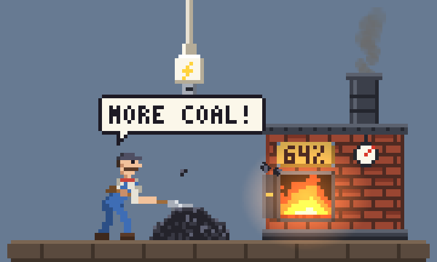
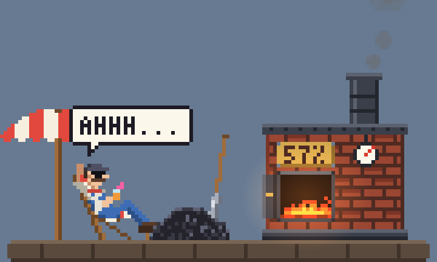
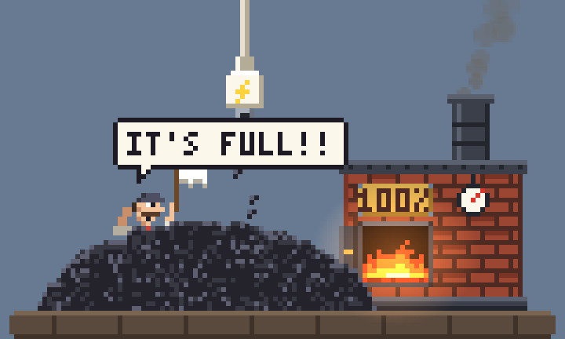

# Stoker

A little pixel-art worker that lives in the corner of your Mac's screen and reacts to your charger.



- **Charging:** shovels coal into the furnace. A faster charger means faster shovelling.
- **Unplugged:** throws the shovel away and gets out the beach chair.
- **Low battery:** starts panicking.
- **100%:** gets buried in coal.
- **Charging paused** (optimized charging): coffee break.
- **Charger too weak** (the battery drains while plugged in): shovels flat out and sweats while the fire still dies down. The plaque turns red and alternates with how many watts the battery is losing.

The plaque on the furnace shows your battery percentage.




## Install

You need macOS 13 or newer and the Xcode Command Line Tools (`xcode-select --install`).

```
git clone https://github.com/Null-dk/Stoker.git
cd Stoker
./build.sh --install --run
```

It runs from the menu bar. There you can change the size and position, turn off the sound, or preview each mood without unplugging your charger.

Don't want him on your desktop? Choose **Show Worker → In the Menu Bar**. He moves into a tiny animated icon in the menu bar; click it to open the furnace in a popover (click him there to poke him), and right-click for settings. While the popover is closed the scene is paused and silent.

All the art and sounds are generated in code, so there are no asset files.
